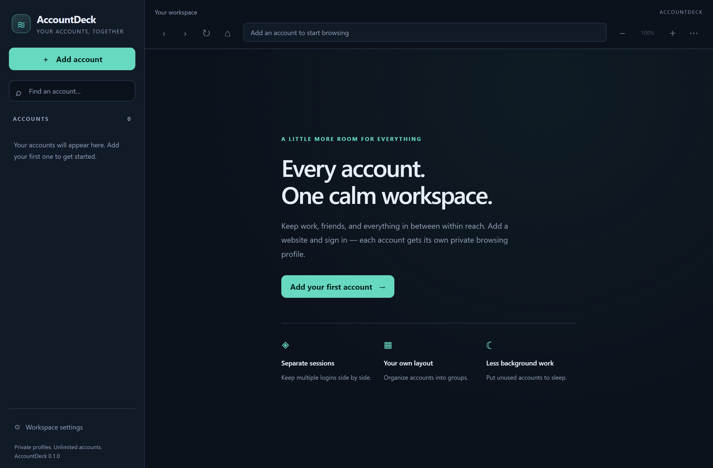

# AccountDeck

A portable Windows x64 multi-account browser with a Rust host and an embedded HTML interface. It uses the installed Microsoft Edge WebView2 runtime. No installer, administrator access, account subscription, or activation key is used.

[Download for Windows](https://github.com/mitty212/AccountDeck/releases/latest) · [Validation](qa/VALIDATION.md) · [MIT license](LICENSE)



## Run

Double-click `AccountDeck.exe` from a folder you can write to. Click **Add account**, choose a service or enter a home URL, and give the account a name. Add the same site again for another independent login.

Keep the `AccountDeck-data` folder beside the executable. It holds account settings and a separate persistent browser profile for every account. Moving or replacing only the executable is safe if it stays next to the same data folder. To select another workspace:

```powershell
.\AccountDeck.exe --data-dir "G:\My Accounts"
```

On systems without WebView2, install Microsoft's Evergreen WebView2 runtime using its per-user option. The runtime is already present on the development computer. AccountDeck itself never requests elevation. Windows 10/11 x64 is the intended target; testing was on this Windows computer.

## Sessions and account controls

Cookies, local storage, IndexedDB, cache, and browser-managed saved passwords belong to each profile and persist across normal app exits and Windows restarts. Session-only cookies are additionally saved in an encrypted snapshot every 30 seconds and on normal close, then restored before the next navigation. Snapshots use Windows DPAPI under the current Windows user; do not expect copying the data folder to another Windows user or computer to transfer working logins. Do not delete or rename the data folder if you want to keep sessions.

Websites control their own session expiry, sign-outs, two-factor authentication, and embedded-browser login restrictions. AccountDeck cannot prevent a site from requiring authentication again. No passwords are captured by AccountDeck's interface. A sudden power loss or forced process kill can lose changes since the latest snapshot. This app does not automatically launch at Windows sign-in; open it again to resume.

Available without activation: multiple persistent accounts, custom home URLs, groups, pinning, ordering, independent duplicate accounts, per-account audio mute, notification pause, sleep/resume, navigation, zoom, downloads, same-profile popup windows, dark/light themes, metadata import/export, developer tools, and an Argon2 workspace password lock. Location/camera/microphone requests use the browser's normal permission prompts. Notification delivery also depends on Windows and website support.

The optional blocker covers a bundled set of common advertising/tracking hostnames. It is a basic domain blocker, not an equivalent of the original application's full filter-list engine. Turn it off for a site that stops working.

**Duplicate** copies an account's preferences into a new, signed-out profile. **Sleep** stops that account's browser while retaining its login data. **Delete** removes the account from the workspace and schedules removal of its local browser data at the next launch if Chromium still has files open; it does not delete an online account. Account-list exports contain settings only, not cookies, sessions, or passwords.

The workspace password locks the application's interface. It is not full-disk encryption or protection against someone who can modify the workspace files under your Windows login.

Keyboard shortcuts work when workspace controls have focus: Ctrl+L address, Ctrl+K account search, Ctrl+N add account, Ctrl+1–9 switch accounts. Embedded sites retain their own keyboard handling.

## Build and verify

Install the Rust MSVC toolchain and Visual Studio C++ build tools, then:

```powershell
cargo test --locked
cargo build --release --locked
```

The executable is `target\release\accountdeck.exe`. The C runtime is linked statically and the application manifest requests `asInvoker` execution. Source is independent of the inspected vendor application; vendor code, images, fonts, license key, telemetry, store integration, updater, and marketing are not distributed.

A real WebView2 persistence test is provided in `qa/check_persistence.py`. It runs a local fixture, starts separate seed and verify processes, and checks profile isolation and encrypted cookie recovery without logging into third-party services. See `qa/VALIDATION.md` for the recorded validation results.

This is an independent implementation. Original vendor packages, recovered vendor sources, reverse-engineering evidence, browser profiles, credentials, and local test workspaces are excluded from this repository. Full equivalence with the reference application and compatibility with every social service have not been established.
